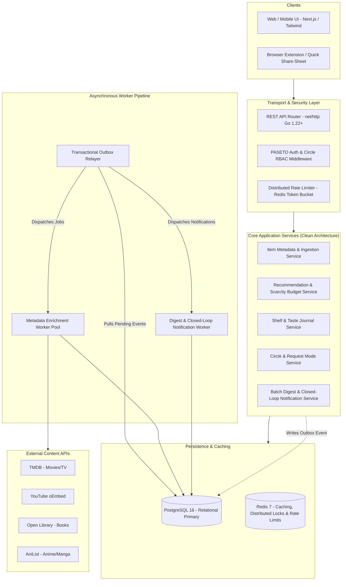
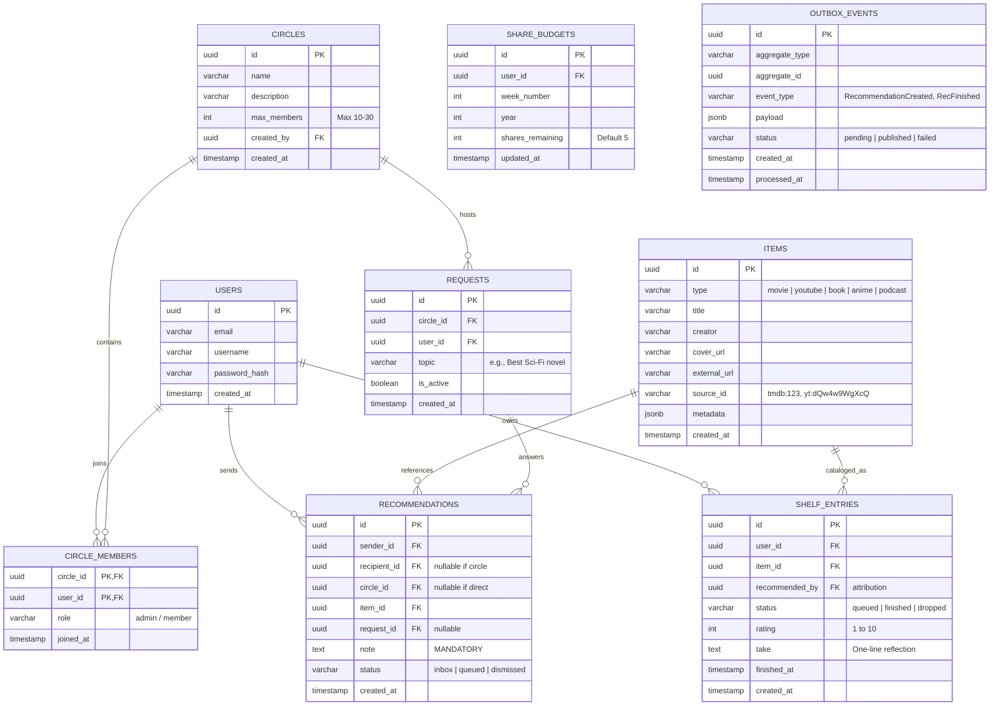

# Recco: Product Specification & Engineering Action Plan
> **Tagline:** *Recommended by people, not algorithms. No feed. Just friends.*  
> **GitHub About:** *Recco: a quiet, friends-only space to share and rate movies, music, books, podcasts, YouTube videos, and anime. Recommended by people, not algorithms.*

---

## 1. Product Philosophy: The Anti-Distraction Paradigm

Modern social platforms trap users in algorithmic rabbit holes driven by engagement-maximizing feeds, vanity metrics (follower counts, like counts), and infinite scrolling. 

**Recco** is built on the opposite premise:
> The best mechanism for discovering great culture is **word-of-mouth from people whose taste you trust**, not an algorithm trained to keep you glued to a screen.

### The 4 Pillars of Focused Sharing

```
┌─────────────────────────────────────────────────────────────────────────────┐
│                           THE RECCO PRODUCT CYCLE                           │
│                                                                             │
│  [Intentional Share] ──► [Finite Inbox] ──► [Personal Queue] ──► [Shelf]   │
│   (Mandatory Note +       (Inbox Zero =       ("Want to read/     (Rating + │
│    Weekly Budget)          App is done)        watch/listen")      Take)    │
│                                                     │                       │
│                                                     ▼                       │
│                                            [Closed-Loop Notice]             │
│                                          (Sender sees your rating)          │
└─────────────────────────────────────────────────────────────────────────────┘
```

1. **From Feed to Finite Inbox and Shelf**:
   - **No Infinite Feed**: There is no algorithmic timeline. Recommendations sent directly to you or your small circle land in a **finite inbox**. When your inbox is empty, you reach **Inbox Zero** and the app is done.
   - **Personal Queue & Shelf**: Accepting a recommendation moves it to your **Queue** (*"want to watch/read/listen"*). When completed, it transitions to your **Shelf** with a personal rating and an optional one-line take. Recco is a **taste journal first**, and a social utility second.
   - **External Links Only (No Autoplay Rabbit Holes)**: Recco displays cover art, rich metadata, and the friend's personal note, then opens the original content directly in its native app (YouTube, Spotify, Netflix, Goodreads).

2. **Intentionality & Scarcity**:
   - **Mandatory "Why" Note**: Every share requires a note (e.g., *"You'd love this because of the ending"*). Link-dumping is impossible.
   - **Weekly Share Scarcity Budget**: Users get a finite budget (e.g., **5 shares per week**). Scarcity forces deliberate curation.
   - **Request Mode**: Instead of searching algorithmic trending pages, users can post a quiet prompt to their circle: *"Looking for a good book on systems thinking"*, allowing friends to reply with recommendations.

3. **Small Circles Over Public Audiences**:
   - **Hard Membership Caps**: Circles are capped at **10 to 30 people** (Dunbar-friendly). Circles can be themed (e.g., *"Sci-Fi Film Club"*, *"Backend & Systems Reading"*).
   - **Zero Vanity Metrics**: No public follower counts, no like buttons, no trending tags, no global leaderboards. Ratings belong to the individual and their circle.

4. **Closed-Loop Feedback & Calm Notifications**:
   - **Closed Loop**: When a friend finishes something you recommended, you receive a quiet notification with their rating and reaction. This replaces the cheap dopamine of a "like" with genuine fulfillment.
   - **Batched Digests**: Summary digests replace frantic real-time push notifications. No red badge counters.

---

## 2. Technical Architecture & Go Backend Showcase

While Recco is a calm, quiet product on the outside, its backend showcases **senior-level distributed systems engineering** in Go:

| Challenge | Architectural Solution | Backend Skill Demonstrated |
|---|---|---|
| **Atomic Share Budgeting** | Redis atomic counters + PostgreSQL transactional rollbacks | Concurrency safety, distributed state management, data integrity |
| **Universal Metadata Ingestion** | Worker pool pipeline with `singleflight` deduplication for TMDB, YouTube oEmbed, Open Library, AniList | Goroutine concurrency, context timeouts, anti-stampede caching |
| **Outbox & Asynchronous Digest Engine** | Transactional Outbox pattern with background workers & Dead Letter Queues (DLQ) | Event-driven architecture, at-least-once delivery, decoupled async jobs |
| **Finite Inbox & Taste Journal** | Indexed cursor-based pagination, Read-Through / Cache-Aside caching via Redis | Query performance optimization, DB connection pooling (`pgxpool`) |
| **Dual Transport (REST + gRPC)** | REST API (Go 1.22+ `net/http`) for web & mobile; gRPC for internal worker communication | Multi-protocol architecture, Protobuf contract design |
| **Security & Privacy** | Short-lived PASETO/JWT with refresh token rotation + Circle RBAC/ABAC authorization | Token cryptography, middleware design, tenant isolation |
| **Production Observability** | OpenTelemetry (distributed traces) + Prometheus metrics + structured `log/slog` | Telemetry pipelines, Grafana dashboards, SLA monitoring |

---

## 3. High-Level Architecture Diagram



---

## 4. Universal Data Model & Relational Schema (PostgreSQL)

### 4.1 Schema Design Principles
1. **Universal Item Abstraction**: A single `items` table handles all media (Movies, YouTube, Books, Anime, Podcasts) via a `type` discriminator and a flexible `metadata` JSONB column.
2. **First-Class Scarcity**: A `share_budgets` table tracking weekly allocation limits per user.
3. **Finite State Workflow**: Recommendations and Shelf entries follow strict state machines (`pending` → `queued` → `finished` / `dismissed`).



---

## 5. Project Layout (Standard Go Project Structure)

```text
recco/
├── cmd/
│   ├── api/                     # REST & WebSocket API HTTP server
│   │   └── main.go
│   ├── worker/                  # Background worker (Outbox, Enrichment, Digests)
│   │   └── main.go
│   └── seeder/                  # Synthetic test data & benchmark generator
│       └── main.go
├── internal/
│   ├── domain/                  # Pure Business Entities & Repository Interfaces
│   │   ├── user.go
│   │   ├── circle.go
│   │   ├── item.go
│   │   ├── recommendation.go
│   │   ├── shelf.go
│   │   ├── budget.go
│   │   └── errors.go            # Domain-specific sentinel errors
│   ├── service/                 # Use Cases & Business Logic
│   │   ├── auth_service.go
│   │   ├── recommendation_service.go  # Enforces note presence & weekly budget
│   │   ├── shelf_service.go           # Triggers closed-loop feedback events
│   │   ├── item_service.go            # Metadata aggregation via worker pool
│   │   └── circle_service.go
│   ├── repository/              # Data Access Layer (PostgreSQL & Redis)
│   │   ├── postgres/
│   │   │   ├── user_repo.go
│   │   │   ├── item_repo.go
│   │   │   ├── recommendation_repo.go
│   │   │   ├── shelf_repo.go
│   │   │   ├── budget_repo.go
│   │   │   └── outbox_repo.go
│   │   └── cache/
│   │       ├── redis_budget.go        # Redis atomic INCRBY / DECR for budgets
│   │       └── redis_cache.go
│   ├── transport/               # HTTP & Protobuf Handlers
│   │   ├── http/
│   │   │   ├── router.go              # Go 1.22+ ServeMux routing
│   │   │   ├── middleware/            # Auth, TraceID, RateLimit, Logging
│   │   │   └── handler/
│   │   │       ├── auth_handler.go
│   │   │       ├── recommendation_handler.go
│   │   │       ├── shelf_handler.go
│   │   │       └── circle_handler.go
│   │   └── grpc/
│   │       └── item_service.go        # Internal item enrichment gRPC server
│   ├── worker/                  # Async Background Tasks
│   │   ├── outbox_processor.go        # Transactional outbox polling & dispatch
│   │   ├── enrichment_pipeline.go     # TMDB, YouTube, Open Library fetchers
│   │   └── digest_notifier.go         # Batched digest & closed-loop notifications
│   └── platform/                # Cross-Cutting Infrastructure
│       ├── config/                    # 12-factor environment loader
│       ├── database/                  # pgxpool connection pool management
│       ├── logger/                    # Structured slog with JSON & colored dev outputs
│       └── telemetry/                 # OpenTelemetry traces & Prometheus metrics
├── migrations/                  # Versioned SQL migrations (golang-migrate)
│   ├── 000001_create_users_table.up.sql
│   ├── 000002_create_circles_table.up.sql
│   ├── 000003_create_items_table.up.sql
│   ├── 000004_create_recommendations_and_shelf.up.sql
│   └── 000005_create_outbox_table.up.sql
├── web/                         # Minimal, focused web client (Next.js or Go templates)
├── api/proto/                   # Protobuf definitions
├── docker/
│   ├── Dockerfile.api
│   ├── Dockerfile.worker
│   └── docker-compose.yml
├── Makefile                     # Build, test, migrate, benchmark commands
├── go.mod
├── go.sum
└── README.md
```

---

## 6. Phased Implementation Roadmap

### Phase 1: Core Foundation & Taste Journal (Personal Shelf)
- [ ] Initialize Go module (`github.com/yourusername/recco`).
- [ ] Setup `internal/platform/config` and structured logging with `log/slog`.
- [ ] PostgreSQL connection pool with `jackc/pgx/v5` and versioned SQL migrations (`000001` through `000003`).
- [ ] Implement Universal Item Model (`items` table) and manual entry creation.
- [ ] Build personal **Shelf & Queue** CRUD:
  - Add to Queue (*"want to consume"*).
  - Move to Shelf (*"finished"* with 1–10 rating and one-line take).
- [ ] Hermetic integration tests using `testcontainers-go` for PostgreSQL.

### Phase 2: Metadata Enrichment Pipeline & Concurrency
- [ ] Implement external metadata providers:
  - **YouTube oEmbed**: Zero-auth public metadata (title, creator, thumbnail).
  - **TMDB API**: Movie and TV show poster, director, release year.
  - **Open Library API**: Book author, cover, description.
- [ ] Build concurrent **Worker Pipeline**:
  - Goroutine pool with worker limits.
  - `singleflight.Group` to deduplicate concurrent requests for the same URL.
  - Redis cache layer for third-party API results (reduce latency and rate-limit hits).

### Phase 3: Small Circles, Finite Inbox & Intentional Sharing
- [ ] Implement Circles with strict size limits (10–30 members max).
- [ ] Implement **Recommendation Engine**:
  - Enforce mandatory note validation (minimum 10 characters, no empty link dumps).
  - Enforce **Weekly Scarcity Budget** (atomic Redis check & decrement, reset every Monday UTC).
- [ ] Implement the **Finite Inbox**:
  - Clean API returning only pending recs.
  - Actions: *Accept to Queue* or *Dismiss*.
  - When empty, API signals `inbox_zero: true`.

### Phase 4: Event-Driven Transactional Outbox & Closed-Loop Feedback
- [ ] Implement **Transactional Outbox Pattern**:
  - Write business state change + outbox event in the same DB transaction.
  - Standalone worker (`cmd/worker`) to poll, publish, and mark events processed.
- [ ] Implement the **Closed-Loop Notification**:
  - Event: `ShelfEntryCompleted(user_id, item_id, recommended_by, rating, take)`.
  - Sends a direct quiet notification back to the original recommender.
- [ ] Implement **Request Mode**:
  - Post topic to circle.
  - Members can respond directly with linked recommendations.

### Phase 5: Security, Rate Limiting & Dual Transport
- [ ] PASETO / JWT stateless authentication with cryptographic token pairs.
- [ ] Role-based circle permission checks (Circle Admin vs. Member).
- [ ] Distributed Rate Limiting middleware via Redis Token Bucket.
- [ ] gRPC service definition (`item.proto`) for internal metadata extraction.

### Phase 6: Observability, Web Showcase & Production Packaging
- [ ] Instrument OpenTelemetry tracing across all HTTP handlers, DB queries, and worker tasks.
- [ ] Export Prometheus metrics:
  - `recco_shares_created_total{content_type}`
  - `recco_share_budget_exhausted_total`
  - `recco_inbox_zero_reached_total`
  - `recco_http_request_duration_seconds`
- [ ] Build clean, quiet Web UI (focused queue, empty inbox celebration screen, personal shelf).
- [ ] Multi-stage scratch/distroless Dockerfile (<20MB container footprint).
- [ ] Complete CI pipeline with `golangci-lint`, test coverage, and `govulncheck`.

---

## 7. Concrete Next Steps to Begin

1. **Step 1**: Initialize `go.mod` and directory scaffolding.
2. **Step 2**: Create PostgreSQL migration scripts for `users`, `items`, and `shelf_entries`.
3. **Step 3**: Implement the Universal Item domain model and metadata ingestion service.
4. **Step 4**: Set up the database pool and write repository tests.
